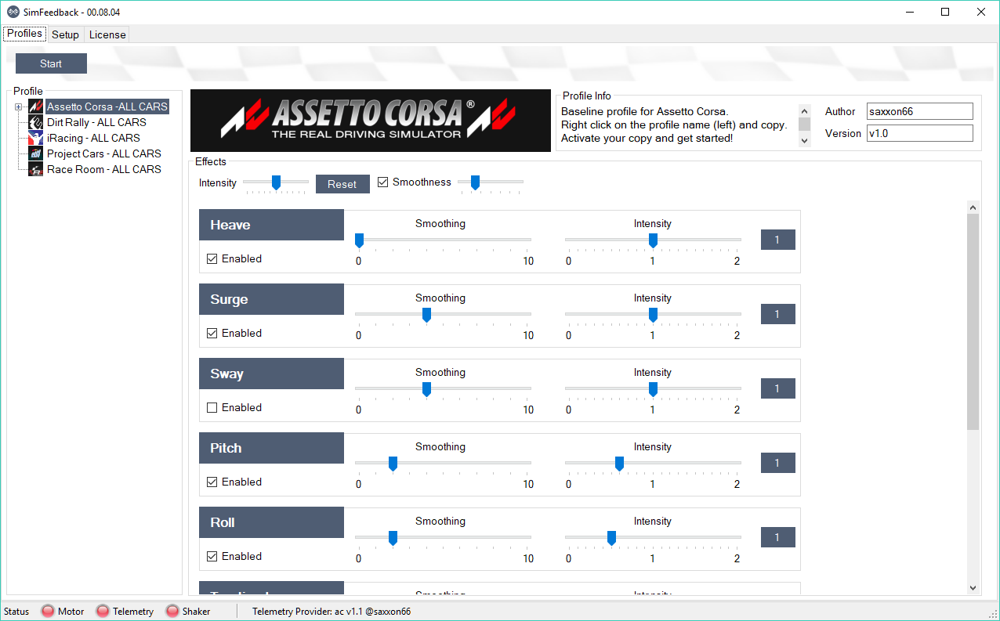
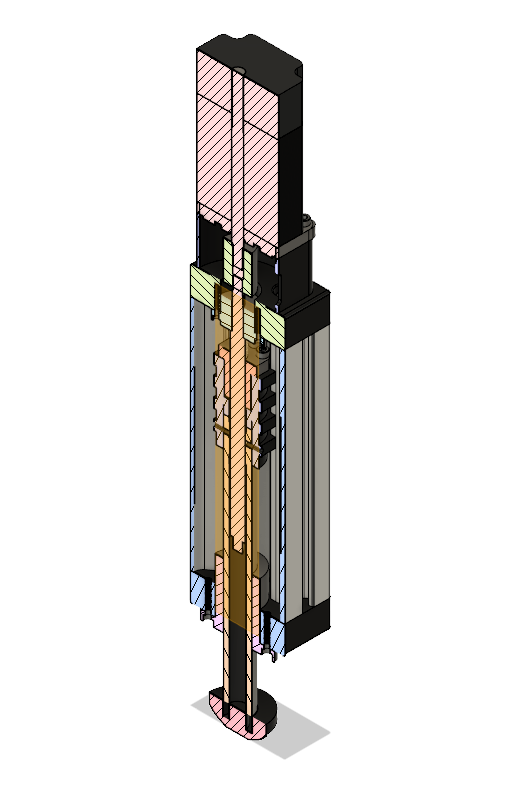
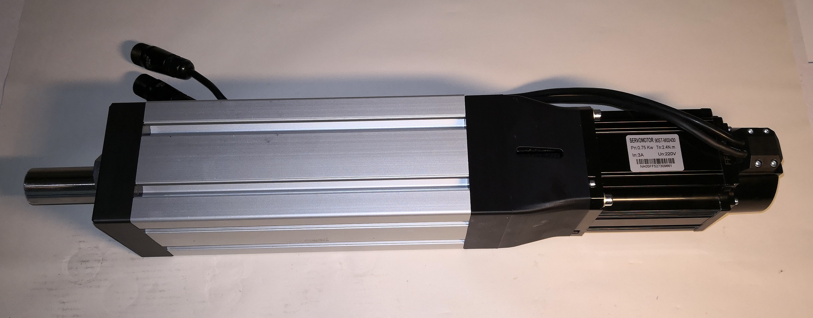

# SimFeedback-AC-Servo

## SFX-100 — Open-Source Motion Sim Platform

SimFeedback is PC software that receives telemetry from racing and flight simulations
(iRacing, Assetto Corsa, Project Cars, MSFS, ...) and translates it into motion cues.
The motion commands are sent to an Arduino-based microcontroller, which drives four
closed-loop AC servo actuators (SFX-100).

This repository contains everything you need to build your own SFX-100 motion rig:
the linear actuator design, the electronics, the firmware, and the SimFeedback software.
Use it as it is — no registration, no sponsor, no donation required.

## License

The SFX-100 design and the SimFeedback software are **free for private use**.
**Commercial use is not permitted.** See the [License](../../wiki/License) and the
[FAQ#Commercial](../../wiki/FAQ) for details.

## Documentation

- **Build guide & technical docs:** [Wiki](../../wiki)
- **Community build blog by Rowan:** https://www.rowanhick.com/sfx-100-build-and-running-guide
- **German community (VR-Forum):** https://forum.virtualracing.org/showthread.php/109282-DIY-3KW-Motion-Sim-Rig-Coming-Soon
- **iRacing forum thread:** http://members.iracing.com/jforum/posts/list/3616928.page
- **Website:** https://opensfx.com

## SimFeedback in Action

### SimFeedback Software

### SFX-100 Linear Actuator Design

